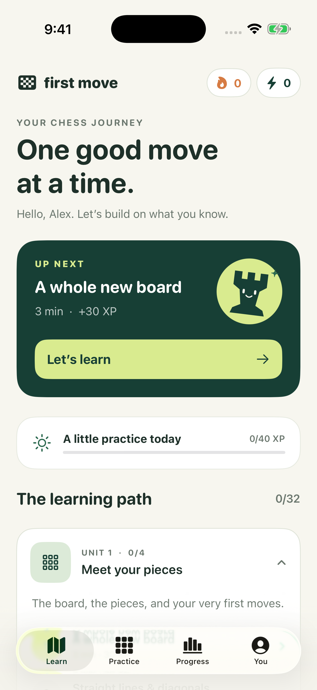

# First Move

A native iPhone chess trainer for complete beginners. Built in SwiftUI, with an original ivory-and-forest-green design, a friendly rook character, and a course you can use offline.



## What is implemented

- A 32-lesson learning path across eight units: pieces, rules, openings, tactics, attack and defense, planning, endgames, and a thinking routine.
- 108 lesson steps, including explanations, 70 knowledge/move questions, and 45 board diagrams. Exercises allow unlimited retries and explain the idea behind an answer.
- Interactive legal-move highlighting, promotions, castling, en passant, king safety, checkmate, and stalemate.
- XP, configurable daily goals, calendar-day streaks, milestones, and spaced lesson reviews. First completion earns the lesson's XP; reviews earn 5 XP once per lesson per day.
- A local practice board with a simple two-ply sparring bot, two-sided exploration, undo, board flipping, repetition claims, and draw handling. Practice-board games are temporary and award no XP.
- Local progress, JSON backups/restores, profile separation, and optional native Sign in with Apple plus iCloud key-value synchronization.
- Accessible board-square names, legal-destination announcements, labeled controls, Dynamic Type body text, and a reduced-motion setting respected in lesson animations.
- No ads, hearts, subscriptions, third-party tracking, or runtime package dependencies.

No course promises mistake-free games. First Move builds a foundation and habits that improve through practice and review.

## Current status

The native app compiled successfully with Xcode 26.6 on a hosted Mac on November 5, 2026. All **35 unit tests and 2 UI tests passed**, with zero failures, on an iPhone Air simulator. The captured learning-path screenshot was visually inspected. [View the successful build](https://github.com/xMelissaa/first-move/actions/runs/42095101106).

The tested app source is commit `400b1bafaec3b6ce338cc4b1a04bd770a62d8859`. This package is source, not a signed iPhone installer. Apple sign-in, iCloud round trips, TestFlight distribution, and physical-device checks remain for the signed release after Apple enrollment.

You do not need to own a Mac. Follow [CLOUD-BUILD.md](CLOUD-BUILD.md) to use GitHub's hosted Mac for an unsigned simulator build and tests. GitHub usage limits depend on your account. A simulator `.app` is not an iPhone installer.

Later, Apple Developer Program membership and your own signing setup enable TestFlight installation. The source defaults to local profiles, with Apple/iCloud capabilities switched off until the registered App ID and provisioning profile support them. Do not put credentials into chat or source files.

## Project map

| Path | Purpose |
| --- | --- |
| `project.yml` | XcodeGen project, native app and test targets |
| `Knightly/` | SwiftUI app source; folder name retained from the initial working title |
| `Knightly/Resources/course.json` | Complete bundled course |
| `Knightly/Core/ChessPosition.swift` | Pure Swift legal chess rules |
| `Knightly/Core/ProgressStore.swift` | XP, streaks, local persistence and optional iCloud merge |
| `KnightlyTests/` | Rules, oracle, progress and course XCTest suites |
| `FirstMoveUITests/` | Onboarding, lesson, persistence and practice-board UI tests |
| `.github/workflows/ios.yml` | Cloud simulator build, tests and screenshot artifact |
| `.github/workflows/testflight.yml` | Optional manually triggered signed upload |
| `Tools/` | Development-only content and syntax validators |

## Checks that run on Windows

With Node 22+ and npm installed:

```powershell
npm --prefix Tools install
npm --prefix Tools test
npm --prefix Tools run check:swift
```

The lockfile also supports pnpm. Tooling dependencies are not shipped inside the iPhone app. The independent chess.js oracle contains 128 positions and 440 resulting states. XCTest compares the Swift engine's legal moves and results to that oracle when the Mac build runs.

## Before a signed release

1. Keep the Mac cloud workflow passing after source changes; review its simulator screenshots for layout changes.
2. Register your own permanent bundle ID; replace the placeholder `org.firstmove.chess` before signing.
3. Configure Apple sign-in and iCloud key-value capabilities on that App ID and use a matching distribution profile.
4. Test Apple account login, revocation, offline relaunch, two-device sync, backup restore, and deletion on signed devices. iCloud sync is eventual; the UI reports enabled sync, not a delivery receipt.
5. Check the smallest supported iPhone, a larger iPhone, landscape, VoiceOver, and larger text sizes. The app targets iOS 17+.
6. Set up App Store Connect/TestFlight and any beta-review information before sharing an installation link.

Chess rules were checked against the [FIDE Laws of Chess](https://handbook.fide.com/chapter/E012023). The local bot is a learning partner, not an engine-strength claim or a rating measurement.
